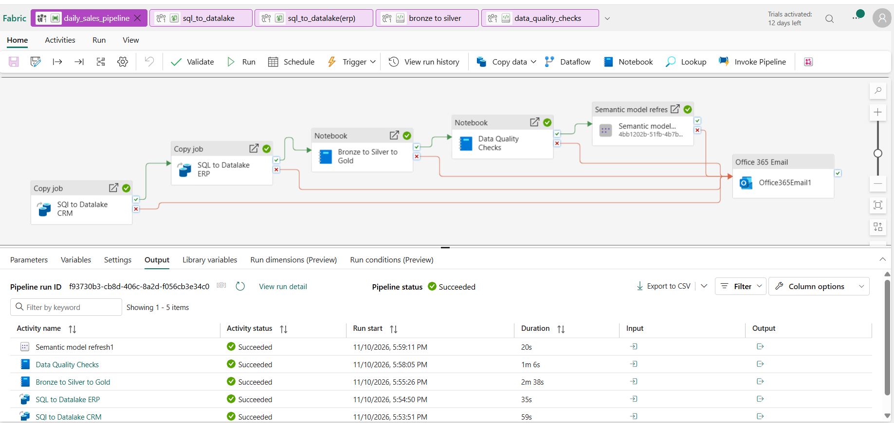
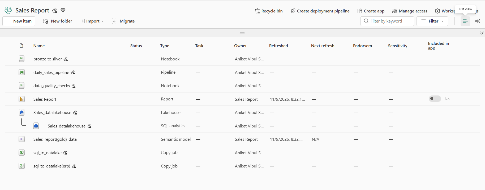
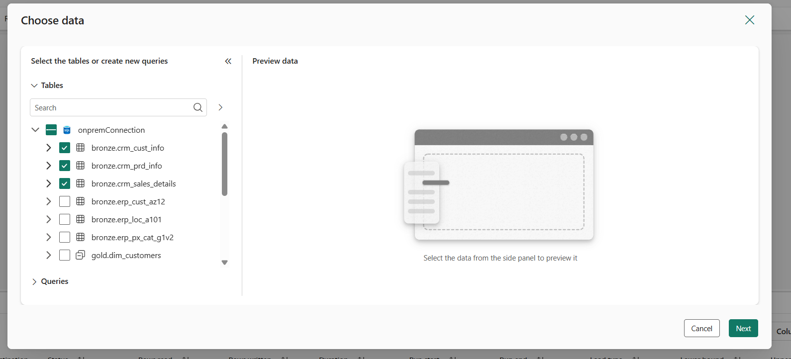
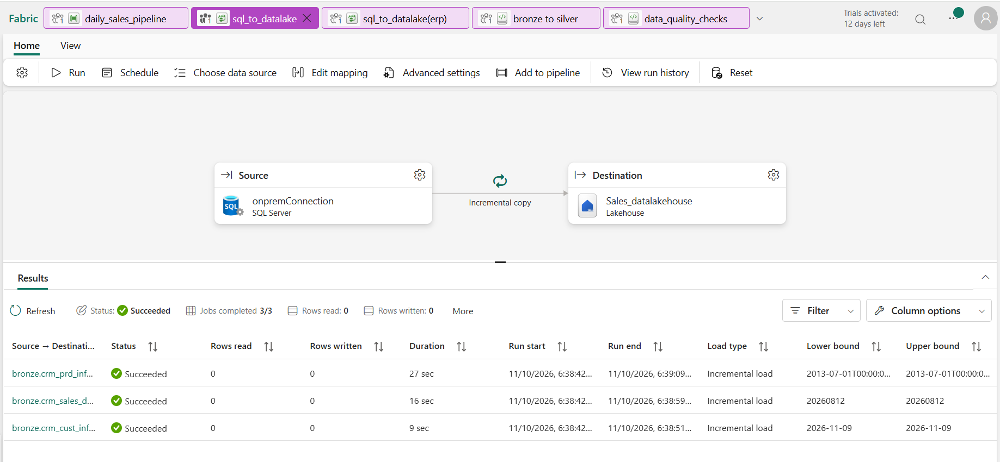
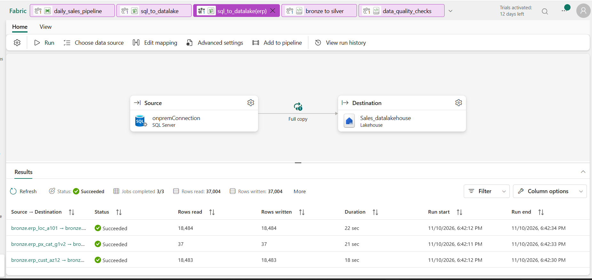
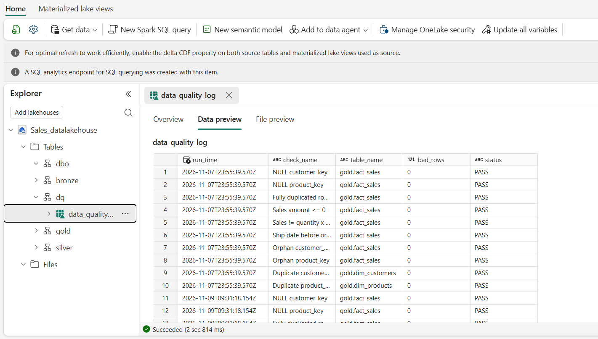

# Fabric Sales Reporting Solution: On-Prem SQL Server to Power BI

End-to-end data engineering project on Microsoft Fabric. It ingests CRM/ERP data from an on-prem SQL Server, refines it through a Bronze → Silver → Gold medallion architecture, and serves a Kimball star schema to Power BI via Direct Lake.

## Architecture

```
On-prem SQL Server (CRM + ERP)
        │  On-premises data gateway
        ▼
Bronze  – Lakehouse, raw data (Copy jobs: incremental for CRM, full copy for ERP)
        ▼
Silver  – PySpark notebooks: cleaning, dedup (ROW_NUMBER), Delta MERGE upserts
        ▼
Gold    – Kimball star schema (fact + dimension tables)
        ▼
Power BI – Direct Lake semantic model + Sales Report
```

Orchestration: Fabric Data Pipeline (`daily_sales_pipeline`) runs the full chain in order: CRM copy → ERP copy → Bronze to Silver to Gold notebook → Data Quality Checks notebook → Power BI semantic model refresh. An Outlook email activity is wired to every failure path (see Notes below).

## Screenshots

**Pipeline orchestration**



**Fabric workspace**



**On-prem SQL Server connection (via gateway)**



**CRM Copy job: incremental load**



**ERP Copy job: full copy**



**Data quality check results (`dq.data_quality_log`)**



## Tech Stack

- Microsoft Fabric (Lakehouse, Data Pipelines, Notebooks)
- PySpark, Delta Lake
- SQL Server (on-prem source) + on-premises data gateway
- Power BI (Direct Lake)

## Key Features

- **Incremental loading (CRM)**: the 3 CRM tables (`crm_cust_info`, `crm_prd_info`, `crm_sales_details`) use a watermark-based incremental Copy job, so only new rows are pulled on each run
- **Full copy (ERP)**: the 3 small ERP reference tables (~37k rows in total) are fully reloaded on each run
- **Data quality checks**: a notebook runs 10 checks on the Gold layer (NULL keys, duplicates, orphan keys, invalid amounts and dates) and logs every run to a `dq.data_quality_log` Delta table
- **Idempotent Silver layer**: Delta `MERGE` upserts so reruns don't create duplicates
- **Deduplication**: `ROW_NUMBER()` window function keeps the latest record per business key
- **Star schema in Gold**: modelled for reporting (Kimball methodology)
- **Direct Lake reporting**: Power BI reads Delta tables straight from OneLake
- **Failure alerting**: an Outlook email activity is connected to each activity's failure path

## Repository Structure

```
├── README.md
├── notebooks/
│   ├── bronze_to_silver.ipynb
│   └── data_quality_checks.ipynb
├── pipelines/
│   └── daily_sales_pipeline.json
└── screenshots/
    ├── pipeline.png
    ├── workspace.png
    ├── onprem-connection.png
    ├── crm-incremental-copy.png
    ├── erp-full-copy.png
    └── data-quality-logs.png
```

## Data Model (Gold)

| Table | Type | Description |
|-------|------|-------------|
| `fact_sales` | Fact | _add grain, e.g. one row per order line_ |
| `dim_customer` | Dimension | _from CRM_ |
| `dim_product` | Dimension | _from ERP_ |
| `dim_date` | Dimension | _date table_ |

<!-- Replace with your actual Gold table names -->

## How It Works

1. **Ingest**: the pipeline copies CRM and ERP tables from on-prem SQL Server into the Bronze Lakehouse through the gateway.
2. **Transform (Silver)**: the `bronze to silver` notebook cleans data, removes duplicates, and upserts into Delta tables with `MERGE`.
3. **Model (Gold)**: Silver data is shaped into a star schema.
4. **Report**: the Power BI semantic model connects to Gold using Direct Lake.
5. **Alert**: any failed activity triggers a Teams message.

## Setup

1. Create a Fabric workspace and Lakehouse.
2. Install and register an on-premises data gateway pointing at your SQL Server.
3. Import the notebooks from `/notebooks` and attach them to the Lakehouse.
4. Import the pipeline from `/pipelines` and re-map connections.
5. Build a Power BI semantic model on the Gold tables.

## Notes

- The failure-alert email activity is configured, but the trial tenant used for this project has no Exchange Online mailbox, so it could not send. In production this would use a shared service mailbox or a Teams channel.

## Author

**Aniket Solanki**: Data / BI Analyst
[LinkedIn](#) · [Portfolio](https://aniketsol.com)
